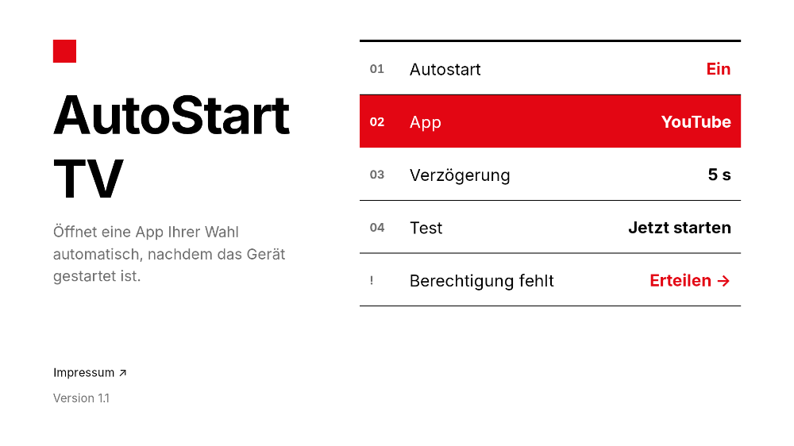
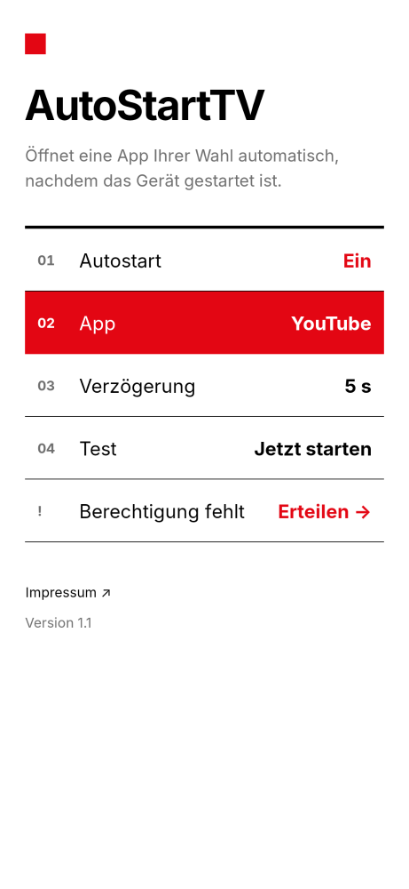

# AutoStartTV

Android-TV-App, die nach dem Einschalten des Fernsehers automatisch eine gewählte App öffnet.
Sprachen: Deutsch und Englisch (folgt der Systemsprache).

Gestaltung im Swiss Style: Weiß, Schwarz, Rot, Grotesk-Schrift (Inter), klares Raster.
Das Layout passt sich an: zwei Spalten auf Fernsehern und großen Bildschirmen,
eine Spalte auf Handys und Tablets. Bedienbar mit Fernbedienung und Touch.




## Bedienung

1. AutoStartTV öffnen.
2. **02 App** wählen und die gewünschte App auswählen.
3. **01 Autostart** steht dann auf *Ein* (umschalten mit OK).
4. Optional **03 Verzögerung** einstellen (0–30 Sekunden nach dem Start).
5. Falls angezeigt: **Berechtigung fehlt → Erteilen** und „Über anderen Apps einblenden“ erlauben.
   Ab Android 10 darf eine App nur mit dieser Berechtigung andere Apps im Hintergrund starten.
   Hat der Fernseher dafür keine Einstellung, per Computer:
   ```
   adb shell appops set de.autostarttv SYSTEM_ALERT_WINDOW allow
   ```
6. Mit **04 Test** prüfen, ob die App startet.

Impressum: https://maltethier.de/impressum.html

## Bauen

```
./gradlew assembleRelease
```
Die APK liegt danach unter `app/build/outputs/apk/release/`.
Bei jedem Push baut GitHub Actions die APK automatisch (Reiter *Actions* → Artefakt *AutoStartTV*).

Installation auf dem Fernseher z. B. per `adb install app-release.apk`.

---

# AutoStartTV (English)

Android TV app that automatically opens a chosen app after the TV has booted.
Choose the app, enable autostart, optionally set a delay, and grant the
"Display over other apps" permission (required on Android 10+).

## Lizenzen

Schrift Inter: SIL Open Font License 1.1, siehe `LICENSE-Inter.txt`.
